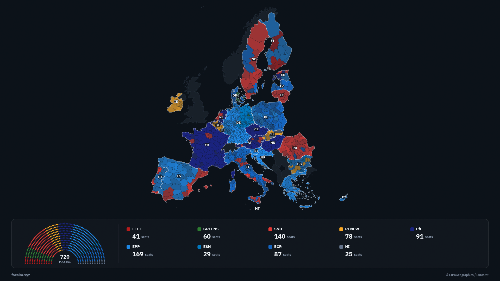
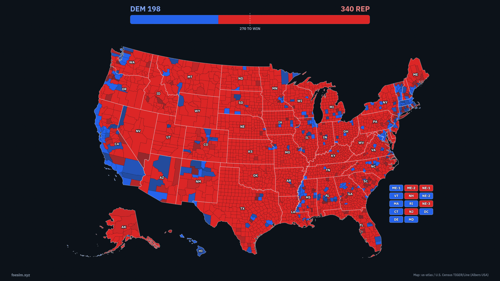

# FOES

Interactive election-night simulator, scenario editor, and Monte Carlo sandbox written in standard-library Go with an HTML5 Canvas map.





### Usage

Requires Go 1.24+. There are no third-party dependencies.

```bash
go run .                              # web UI on http://localhost:8080 (eu27)
go run . -scenario scenarios/usa2024.json
go run . -cli                         # terminal mode
```

Run `go run . -h` to see all CLI flags. A `Dockerfile` is also included if you want to run it in a container.

### Scenarios

- `eu27`: European Parliament across all 27 member states (720 seats, 154 parties, 1,152 NUTS-3 regions), calibrated to 2024 EP results and CHES-Europe.
- `usa2024`: 2024 U.S. Presidential Election (538 EVs, 3,141 counties), including Maine and Nebraska congressional district splits.
- `eu_starter`: Small synthetic 3-country scenario (DE, FR, IT) for quick local testing.

### How it Works

FOES models voter groups and parties in a shared policy space, streaming precinct results over Server-Sent Events as polls close across time zones. Because `eu27` and `usa2024` are calibrated in-sample to 2024 outcomes, running at zero uncertainty closely reproduces the real 2024 results.

In Monte Carlo mode, the simulator runs 100 to 500 correlated draws combining hierarchical uncertainty shocks with optional directional swings to map win probabilities, P10-P90 seat distributions, and closest races. Under winner-take-all rules (like the U.S. Electoral College), symmetric noise still pulls average EV totals toward 270 because narrow swing states have more votes to lose than safe states can gain.

You can switch allocation methods (Sainte-Laguë, D'Hondt, Hare-Niemeyer, FPTP, and a party-level STV approximation) on the same underlying votes, edit scenarios live in the browser by pressing `E`, and share changes via compressed `#share=` URLs. Live runs default to seed `42` for reproducibility.

### Tests

```bash
go vet ./...
go test -race -count=1 ./...
```

### Data & License

Built with Eurostat GISCO NUTS 2021 (© EuroGeographics), 2024 CHES-Europe, European Parliament Open Data, U.S. Census TIGER/Line 2023, and 2024 U.S. county presidential results.

Licensed under [AGPL-3.0](LICENSE) (see [NOTICE](NOTICE) for Section 7 additional terms).